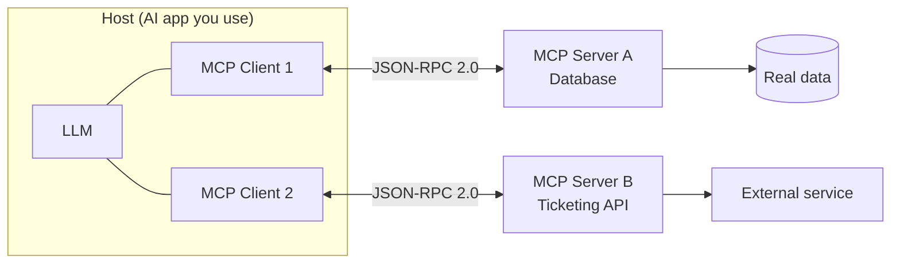
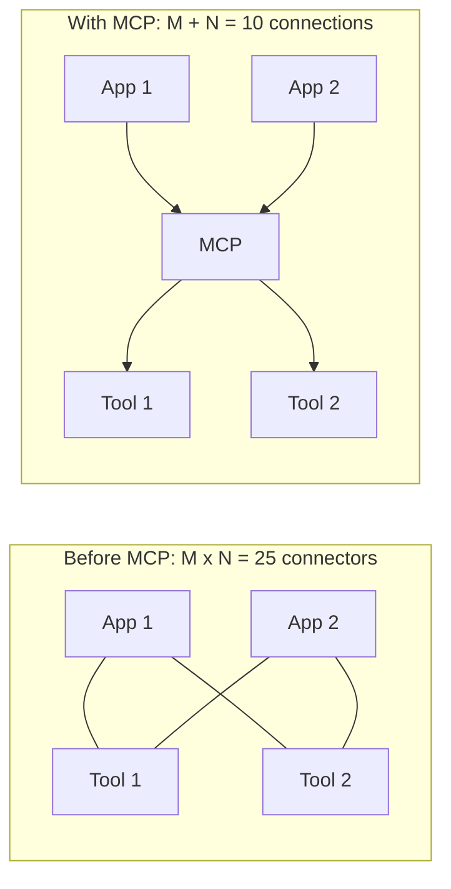

Episode 1: What is MCP? The 2026 Update Every Tutorial Missed

Video: https://www.youtube.com/watch?v=8BodrmxG5U0
Length: 3:21 | Published: 2026-09-15

Summary

MCP stands for Model Context Protocol. It is an open standard created by Anthropic in November 2024. It gives AI applications one consistent way to connect to outside tools, data and systems, instead of every app writing a one-off integration for every tool.

The M x N problem

Old way: M AI apps and N tools need M x N custom connectors. Five apps and five tools means 25 hand-built integrations.
With MCP: everyone builds against one shared interface. The same five apps and five tools need only M + N = 10 connections.
Mental model: USB-C replacing a drawer full of incompatible chargers.

The three roles

Host: the application you actually use (for example a desktop AI assistant or an IDE).
Client: lives inside the host and keeps a one-to-one connection with one server.
Server: a separate program that exposes real capabilities.

A server exposes three things:
- Tools: the model can call them. They have side effects (send an email, create a ticket).
- Resources: read-only data, closer to a GET request than an action.
- Prompts: reusable templates that guide good usage.

Example flow: a coding assistant asks "Why did the last deploy fail?". The client sends a tool call to a database server. The server queries real data and returns a real result, not a guess from training data.

Architecture diagram

M x N versus M + N

How the protocol changed: the July 2026 rewrite

Original design (2024 to mid 2026):
- Client and server did a handshake: initialize, then initialized.
- The server pinned the whole session to one instance using a session ID.
- This model was adopted by OpenAI, Google DeepMind, Microsoft and GitHub. Governance moved to the Linux Foundation.

The problem: a session pinned to one server instance cannot sit behind a normal load balancer. Rolling out a new version drops or stalls sessions.

July 2026 spec (2026-07-28):
- Handshake removed. Session ID removed.
- Every request describes itself: protocol version and capabilities travel with the request.
- List calls can be cached.
- Routing can happen from request headers alone.
- Tasks (long-running work, checked by polling) moved from experimental core to a proper extension, redesigned for the stateless model.
- MCP Apps (servers that ship their own UI) also became an extension.
- Roots, sampling and logging are being phased out over the next year.

Key takeaways

1. M x N is why MCP exists. Mass adoption is why MCP had to change again.
2. Build against the current spec, not the one most tutorials still show.
3. Extensions can be adopted independently, so not every implementation must support everything in core.

Commands

No commands in this episode. It is a concepts episode.

Further reading

- Official site and docs: https://modelcontextprotocol.io
- Specification: https://modelcontextprotocol.io/specification
