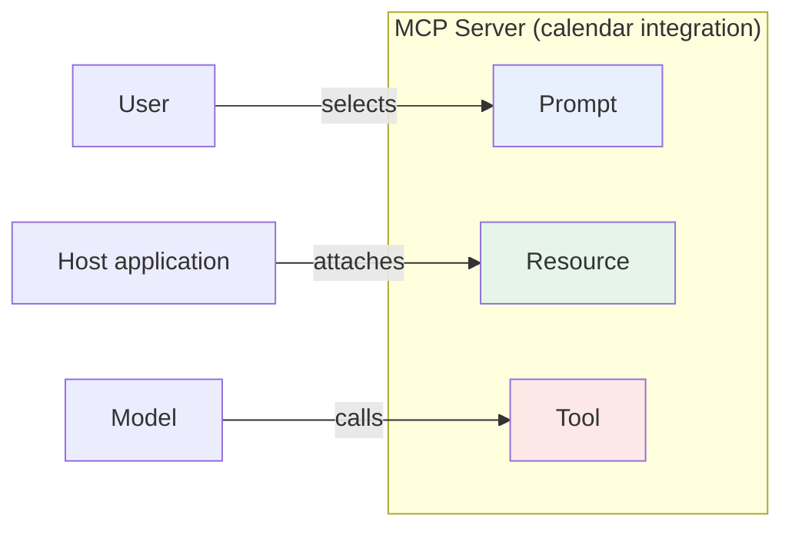
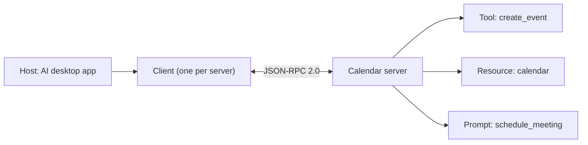

Episode 2: The Six MCP Primitives (Host, Client, Server, Tool, Resource, Prompt)

Video: https://www.youtube.com/watch?v=Q3_SuoMzg4M
Length: 3:46 | Published: 2026-09-26

The six pieces

1. Host: the user-facing app that runs the AI model and orchestrates one or more MCP clients (desktop AI assistant, IDE plugin). It owns the conversation, decides which servers to connect to, and never speaks the MCP wire protocol directly.
2. Client: a stateful one-to-one connector inside the host. It holds one dedicated session with exactly one server. It handles the JSON-RPC handshake and capability negotiation. One client per server connection, always.
3. Server: an external program that exposes tools, resources and prompts. It owns the real integration logic (database, API) and does not know which host it serves.
4. Tool: model-controlled function. The AI decides when to call it during reasoning. Active, can change the world (send email, run a query).
5. Resource: application-controlled, read-only data (file, database record, log). The host decides to attach it as context. Passive, never invoked by the model.
6. Prompt: reusable, user-controlled template. The user invokes it explicitly, like a slash command. The model does not trigger it.

The exam rule: who controls it?

| Primitive | Controlled by | Trigger word |
|---|---|---|
| Tool | The model | Model decides to invoke |
| Resource | The application | Passive, read-only context |
| Prompt | The user | Reusable template the user selects |

Same server, three completely different triggers.

Diagram

Real agent mapping

Wire format

Every client to server exchange is a JSON-RPC 2.0 message: a request, a response, or a notification. It is transport agnostic. The same messages travel over standard input and output (stdio) or over HTTP.

Why not REST, GraphQL or gRPC?

- REST: fixed endpoints, no live model context.
- GraphQL: flexible but request-only.
- gRPC: fast but no capability discovery.
- MCP: standardizes dynamic, model-aware, bidirectional discovery.

Exam drill (memorize the trigger word, not the topic)

- Runs the model and owns the UI: host.
- One-to-one session: client.
- Exposes tools, resources and prompts: server.
- The model decides to invoke it: tool.
- Passive and read-only: resource.
- Reusable template the user selects: prompt.

Commands

No commands in this episode.
