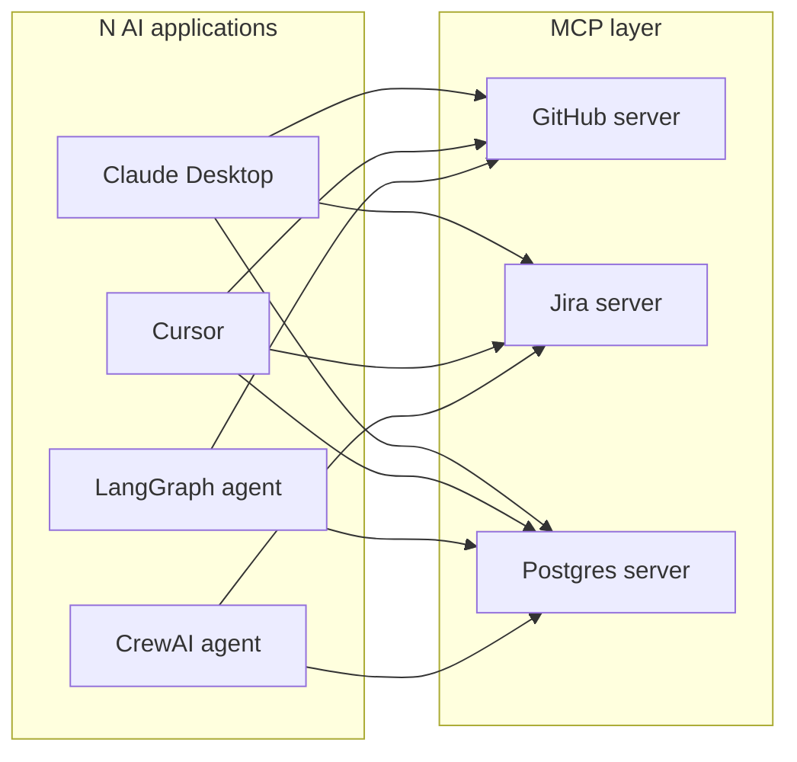
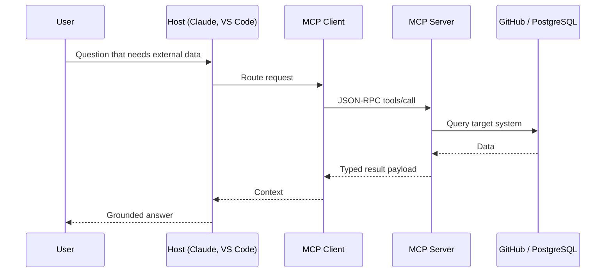

Episode 3: N x M to 1, MCP Interoperability and Portability

Video: https://www.youtube.com/watch?v=ymdCgRUyR1g
Length: 6:55 | Published: 2026-09-30
Hosts: Alex and Elena

The problem

N AI applications (Claude Desktop, ChatGPT, Gemini, Copilot, Cursor, LangChain, Strands, CrewAI) must reach M external systems (GitHub, Jira, Slack, databases, custom APIs). Without a shared protocol each pair needs its own bridge: 8 apps x 8 systems = 64 fragile integrations.

The fix

Put an MCP server in front of each external system. Write one integration per service. Any MCP-compatible host connects instantly.

Three-tier architecture

A host creates one client per server. The server speaks JSON-RPC 2.0 and exposes tools (model invoked), resources (application managed) and prompts (user directed).

Is MCP a framework like LangChain or CrewAI?

No. LangChain, LangGraph, AWS Strands and CrewAI are orchestration frameworks used to build reasoning loops and agent graphs. MCP sits beneath them as the integration protocol. It does not replace REST, GraphQL or gRPC. It wraps external capabilities so any agent framework can reuse the same server without bespoke tool adapters.

Portability: write once, integrate many, reuse everywhere

Build an MCP server for the corporate database. Claude Desktop can query it today. Tomorrow a supervisor agent built with CrewAI or LangGraph connects to the same server. No connector rebuild.

Adoption

Anthropic open-sourced the spec in late 2024. Google, AWS, Microsoft and GitHub adopted it. It is now vendor-neutral under the Linux Foundation family of foundations.

Mental model: USB-C for AI. One standard across devices.

MCPA exam checkpoint

Scenario: a company built an MCP server exposing an internal capability and wants multiple MCP-compatible AI apps to use it without a separate integration per app. Which MCP value is this?
A better model performance, B interoperability and portability, C lower token usage, D stronger fine-tuning.
Answer: B.

Key takeaways

1. MCP solves the N x M integration problem.
2. It gives interoperability across diverse AI applications.
3. Write once, use everywhere.
4. It complements frameworks, it does not replace them.
5. It is the USB-C standard for connecting AI systems.

Commands

No commands in this episode.
