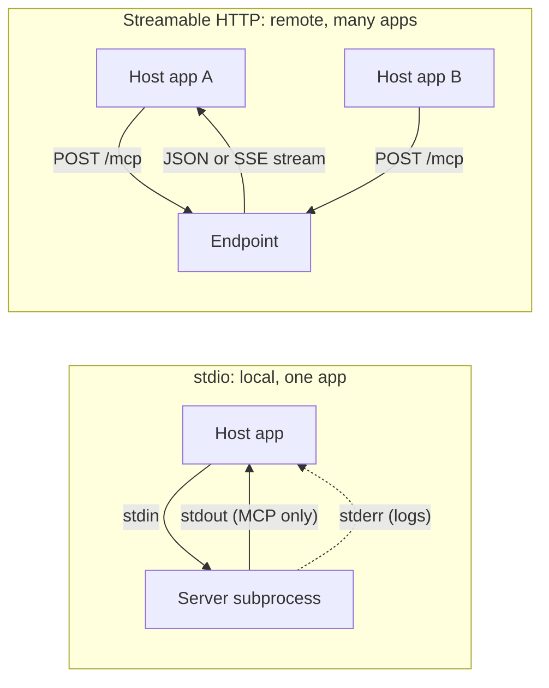
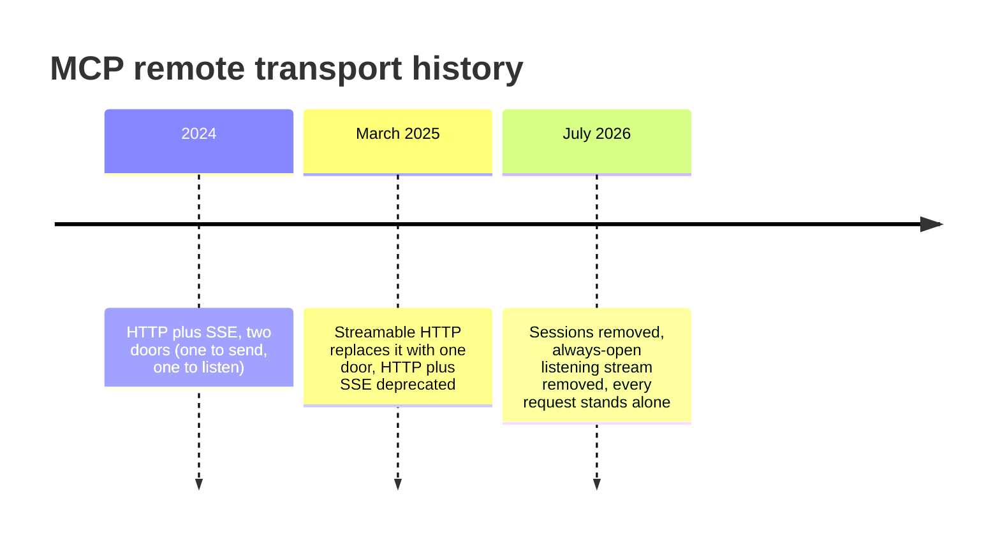
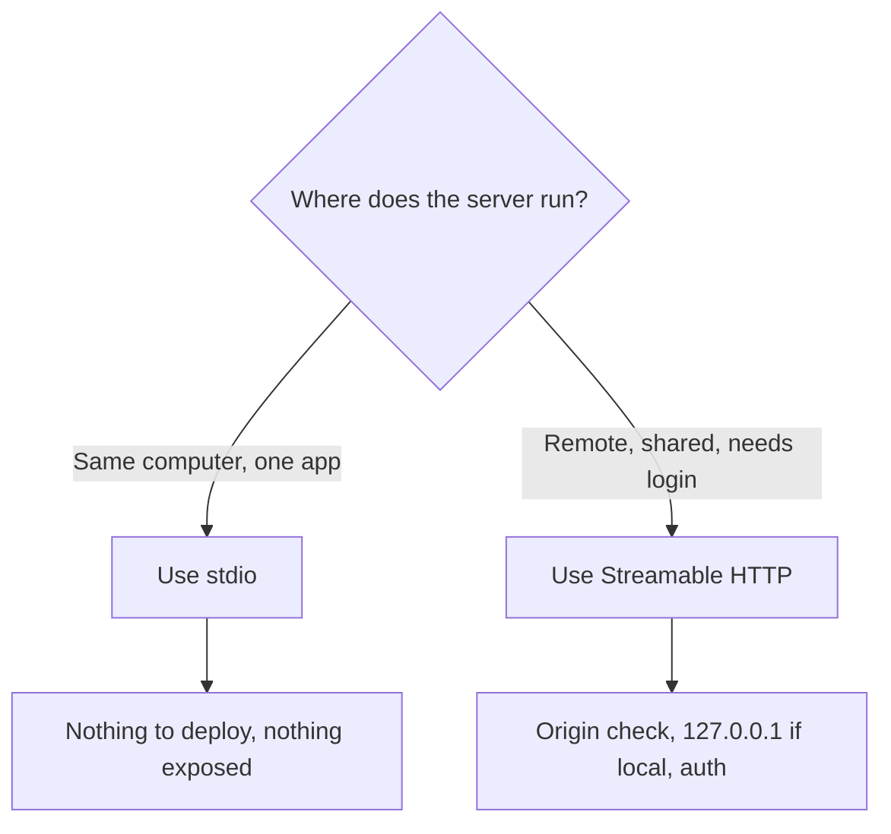

Episode 4: MCP Transport, stdio vs Streamable HTTP (2026 Update)

Video: https://www.youtube.com/watch?v=-kBbfsKatxI
Length: 9:09 | Published: 2026-10-03

What is a transport?

The delivery method for messages between the app and the server. The message itself is always JSON-RPC 2.0. The delivery method can change, the form never does.

stdio (standard input and output)

Analogy: two people at one desk passing notes.
- The app starts the MCP server as a small helper program on your own computer.
- It writes to the server stdin and reads replies from its stdout.
- One message per line. A message can never contain a line break.
- No internet, no network setup.
- Strict rule: stdout is only for MCP messages. Debug prints corrupt the stream and break the connection.
- Human-readable logs go to stderr. The app may read it or ignore it and must not treat it as an error.
- Shutdown: app closes stdin, waits for the process to exit, forces quit only if it takes too long.
- If the helper crashes, the app restarts it and retries lost requests.

Streamable HTTP

Analogy: a busy restaurant counter.
- One endpoint, for example a URL ending in /mcp.
- Each message is a separate HTTP POST.
- Server answers either with one JSON reply, or with a Server-Sent Events (SSE) stream of updates ending in the final result.
- Notifications (no reply needed) get HTTP 202 Accepted.
- Headers act like parcel labels: protocol version, method, and tool name for tool calls. Gateways and load balancers can route without opening the body.
- Safety check: if a header and the body disagree, the server must refuse with 400 (header mismatch).



History (why tutorials disagree)



July 2026 changes
- Sessions removed (the "membership card" kept between requests).
- Always-open GET listening stream removed.
- Old session ID, resumable streams and opening handshake are gone.
- Discovery: a new client asks a simple discovery question first. If the server answers, it is modern. If it fails the way a modern server would not, the client falls back to the older handshake. An old client calling a new server gets a clear 405.
- Servers no longer ask the client questions on their own. If a server needs input it replies that it needs more input and the client asks again with the answer attached.
- Cancel: stdio sends a cancel notification. Over HTTP the client simply closes the stream.

Choosing a transport is a security choice

stdio: runs with the same permissions as your app, not reachable from the internet.
Streamable HTTP: open to the network, needs stronger locks.
- Servers must validate the Origin header and reject bad ones with 403. This blocks DNS rebinding.
- A local HTTP server should bind only to 127.0.0.1.
- Authenticate every connection.

Decision rule



Good habit: build tools once, offer both transports, choose by trust boundary, not convenience.

MCPA exam checkpoint

Many remote AI apps reach one MCP server through a single HTTP endpoint. Which standard transport?
A stdio, B WebSocket, C Streamable HTTP, D gRPC.
Answer: C. WebSocket and gRPC are not standard MCP transports, though the protocol allows custom ones.

Commands

Ep6 shows the actual commands to run a server on each transport:

```bash
uv run mcp run server.py --transport streamable-http
```
