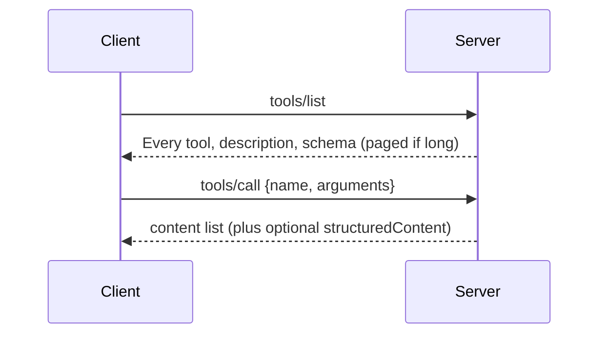
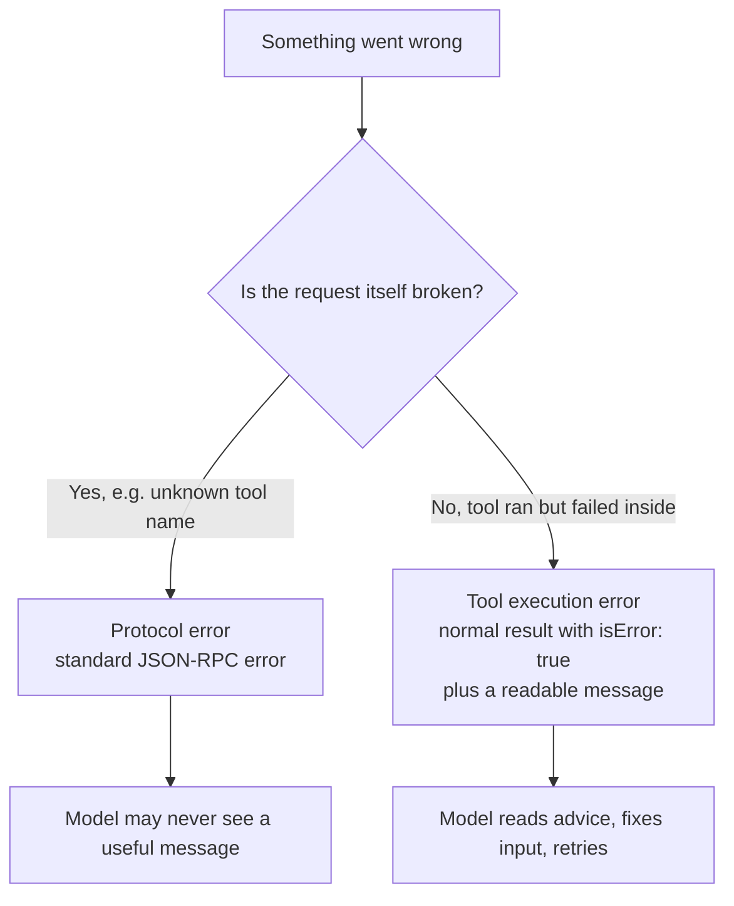

Episode 5: MCP Tools, Why One Wrong Date Can Freeze Your AI Agent

Video: https://www.youtube.com/watch?v=Q8binp4EQV8
Length: 5:50 | Published: 2026-10-04

What is a tool?

One action a server offers to an AI app, such as "get the weather". Tools are model controlled: the model picks them on its own based on your request. Think of a service counter where each window does one job.

Every tool has
1. name: short, no spaces.
2. description: the sign above the window. The model reads it to choose. "tool one" tells it nothing. "Get today's weather for one city in Celsius" says exactly when to use it. Say what the tool does, when to use it, and what it returns.
3. inputSchema: the form the model fills in, in JSON Schema. Lists each field, its type and which are required.

A tool with no inputs uses an empty object with additionalProperties set to false.

```json
{
  "name": "get_weather",
  "description": "Get today's weather for one city in Celsius.",
  "inputSchema": {
    "type": "object",
    "properties": { "city": { "type": "string" } },
    "required": ["city"]
  }
}
```

Discovery and execution



Annotations

Warning stickers on the window: read-only, destructive, idempotent, open-world. They are hints, not guarantees. Apps must treat them as untrusted unless the server itself is trusted.

Safety

- A human should always be able to say no. Apps show which tools exist and ask before sensitive actions.
- Servers must validate every input, control access and rate limit calls.

July 2026 changes
- No sessions. A server that needs memory returns a handle (like a basket ID) and the model passes it back.
- A server can ask for more input.
- Tasks moved to an extension.

The key twist: two kinds of failure



Example: a date in the wrong format is a tool execution error. Return isError true with advice such as "the date must be in the future". The model corrects itself and retries. Reporting it as a protocol error hides the message and the agent stops or repeats the mistake. Mixing the two is the mistake that breaks agents.

Quick reference

| Message | Purpose |
|---|---|
| tools/list | Discover tools |
| tools/call | Run a tool |

MCPA exam checkpoint

A tool call returns isError true. What does it tell you?
A the JSON-RPC request was malformed, B the tool ran but hit an error doing its work, C the server does not support tools, D the client must close the connection.
Answer: B.

Recap

A tool has name, description and input schema. List with tools/list, call with tools/call. Annotations are hints only. Protocol error means the request is broken. isError true means the tool ran but failed, so show the model the message.
