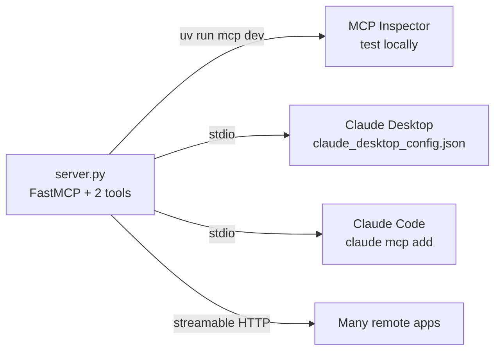

Episode 6: Build Your First MCP Server in Python (20 Lines, Real Tools)

Video: https://www.youtube.com/watch?v=RGryq0Zt9og
Length: 5:58 | Published: 2026-10-06

Goal: build a working MCP server in Python with two tools and use it from Claude.

Prerequisites
1. Python 3.10 or newer
2. uv (Python project manager)
3. Official MCP Python SDK, version 2 or later

Step by step

1. Install uv (see https://docs.astral.sh/uv/getting-started/installation/)

```bash
curl -LsSf https://astral.sh/uv/install.sh | sh
```

On Windows PowerShell:

```bash
powershell -ExecutionPolicy ByPass -c "irm https://astral.sh/uv/install.ps1 | iex"
```

2. Create the project and environment

```bash
uv init mcp-demo
cd mcp-demo
uv venv
uv add "mcp[cli]"
```

3. Create server.py. This one file is the whole server. The code below follows the structure described in the video (FastMCP style decorator API). Check the SDK README if the import path differs in your installed version.

```python
import logging
from datetime import date, datetime

from mcp.server.fastmcp import FastMCP

logging.basicConfig(level=logging.INFO)  # logging writes to stderr, safe for stdio

mcp = FastMCP("demo")


@mcp.tool()
def add(a: int, b: int) -> int:
    """Add two integers and return the sum."""
    return a + b


@mcp.tool()
def days_until(target: str) -> int:
    """Count the days from today until a date in YYYY-MM-DD format."""
    try:
        d = datetime.strptime(target, "%Y-%m-%d").date()
    except ValueError:
        # Raised error reaches Claude with isError true and this advice
        raise ValueError("Use the format YYYY-MM-DD, for example 2026-12-31")
    return (d - date.today()).days


if __name__ == "__main__":
    mcp.run(transport="stdio")
```

Note: the video states the points but shows the code on screen. The snippet above is a faithful reconstruction, not a copy.

What you did not write: no schema. Type hints become the input schema and the docstring becomes the description. These are the two things the model reads (Ep5).

The mistake that breaks first servers

With stdio, the server talks over standard output. A print call corrupts the protocol messages and the connection dies. Use the logging module, which writes to stderr. Rule: for stdio servers, never write to stdout.

4. Test before connecting any app

```bash
uv run mcp dev server.py
```

This opens the MCP Inspector. List tools, call add with two numbers, and send a bad date to see the tool error advice.

5. Connect Claude Desktop

Open the Claude Desktop config file (Settings, Developer, Edit Config) and add:

```json
{
  "mcpServers": {
    "demo": {
      "command": "uv",
      "args": ["--directory", "/ABSOLUTE/PATH/TO/mcp-demo", "run", "server.py"]
    }
  }
}
```

Use the absolute path. If Claude cannot find uv, use the full path to uv (run `which uv`). Fully quit and reopen Claude Desktop after every config change.

6. Connect Claude Code

```bash
claude mcp add demo -- uv --directory /ABSOLUTE/PATH/TO/mcp-demo run server.py
```

7. Try it

Ask Claude: "How many days until the end of the year?". Claude sees the days_until tool, asks approval, and calls it. Try a wrong date format on purpose. Because you raised a tool error, Claude reads the advice and retries.

Flow



Troubleshooting checklist
1. Relative path instead of absolute path.
2. uv not found (use its full path).
3. Any print statement in your code.
4. Quit and reopen Claude Desktop after each config change.
5. Run the server alone first to see its error.

Going remote

stdio runs on your own machine. To serve many apps over the network, run the same server on Streamable HTTP (Ep4):

```bash
uv run mcp run server.py --transport streamable-http
```

Same tools, different delivery.

MCPA exam checkpoint

In a stdio Python MCP server, which action breaks the connection?
A returning a string from a tool, B writing logs with the logging module, C calling print in the server code, D adding type hints to a tool.
Answer: C. Print writes to stdout which carries the protocol messages.

Recap

Install uv and the SDK, create an MCP server, decorate functions with the tool decorator, type hints become the schema, raise a tool error for advice the model can use, never print in a stdio server, test with the Inspector, then connect to Claude.
