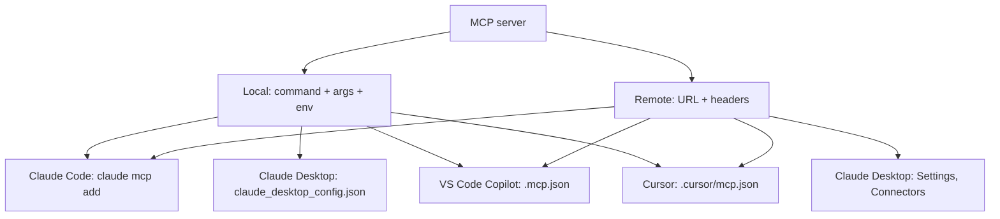
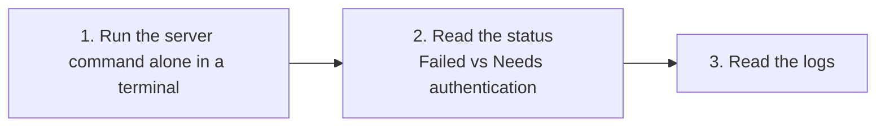

Episode 7: Connect Any MCP Server to Claude, Copilot and Cursor in 7 Minutes

Video: https://www.youtube.com/watch?v=OA19pBHJUMg
Length: 6:58 | Published: 2026-10-12

Core idea: two shapes

Every MCP server reaches your client in one of two shapes.
1. Local server: a program your client starts. It has a command, arguments and maybe environment variables.
2. Remote server: a URL with optional headers.

Every client takes one of these two shapes. What changes is the file it lives in and the name of the root key.



1. Claude Code (no file to edit)

Remote server:

```bash
claude mcp add --transport http <name> <url>
```

Local server:

```bash
claude mcp add --transport stdio <name> -- <command> [args...]
```

The double dash matters. Everything after it goes to the server unchanged, so the server own flags are never read as Claude flags.

Environment variable: put --env before the transport, with at least one other option between it and the name. Otherwise Claude reads your server name as part of the variable.

```bash
claude mcp add --env API_KEY=xxxx --transport stdio myserver -- npx -y some-mcp-server
```

Check health:

```bash
claude mcp list
```

Inside a session, /mcp shows the same status.
- Connected: it works.
- Needs authentication: finish the login.
- Failed to connect: start debugging.

Scopes
- local (default): private to you in this project.
- project: writes a .mcp.json file into the repo; every teammate is asked to approve.
- user: applies to all your projects.
Precedence if the same name exists twice: local beats project, project beats user.

Skip the older SSE transport. Claude Code recommends HTTP.

2. Claude Desktop

Local server: Settings, Developer, Edit Config. Add the server under mcpServers with command and args, save, then fully quit and reopen the app.

```json
{
  "mcpServers": {
    "myserver": {
      "command": "npx",
      "args": ["-y", "some-mcp-server"]
    }
  }
}
```

Remote server: added in the interface. Settings, Connectors, Add custom connector, paste the URL.

3. GitHub Copilot in VS Code

Command palette, run "MCP: Add Server". Choose .mcp.json in your workspace and VS Code writes the file.

Detail that catches people:
- Older .vscode/mcp.json uses root key servers.
- Newer portable .mcp.json uses root key mcpServers, the same key Claude and Cursor use.
- VS Code reads both; the docs recommend the portable one for new servers.
- If a config comes from another client, start with mcpServers.

VS Code asks you to trust a server the first time it starts, so read the command before accepting. Use "MCP: List Servers" to start, stop or read output. In the chat box, "Configure Tools" switches individual tools on or off. Keep secrets out of the file: use input variables or an environment file.

4. Cursor

Project file .cursor/mcp.json, or a global file in the .cursor folder in your home directory. Root key is mcpServers. Local servers take command and args. Remote servers take url and optional headers.

```json
{
  "mcpServers": {
    "local-one": { "command": "npx", "args": ["-y", "some-mcp-server"] },
    "remote-one": { "url": "https://example.com/mcp", "headers": { "Authorization": "Bearer TOKEN" } }
  }
}
```

Turn a server on or off from Customize in the sidebar.

Comparison

| Client | Local server | Remote server | Root key |
|---|---|---|---|
| Claude Code | claude mcp add --transport stdio ... -- cmd | claude mcp add --transport http name url | n/a (CLI) |
| Claude Desktop | Edit Config file | Settings, Connectors | mcpServers |
| VS Code Copilot | .mcp.json | .mcp.json | mcpServers (older file: servers) |
| Cursor | .cursor/mcp.json | .cursor/mcp.json | mcpServers |

Debugging a server that will not connect, in order



Log locations for Claude Desktop: the logs folder under Claude on Mac (~/Library/Logs/Claude), and the logs folder under Claude in AppData on Windows. After every config change in Claude Desktop, quit fully and reopen.

MCPA exam checkpoint

In Claude Code, what does the double dash do in claude mcp add for a local server?
A sets scope to project, B separates Claude options from the server command and its arguments, C switches transport to HTTP, D adds an authentication header.
Answer: B.

Recap

Every MCP server is a local command or a remote URL. Claude Code uses claude mcp add. Claude Desktop uses its config file for local and Connectors for remote. VS Code and Cursor use a JSON file with mcpServers. When something fails, run the command alone first, then read status and logs.
